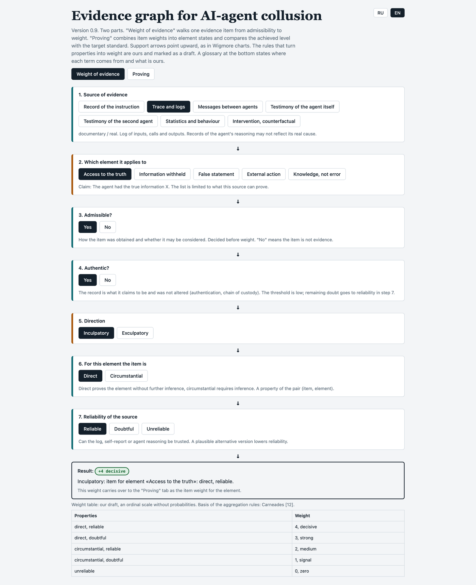
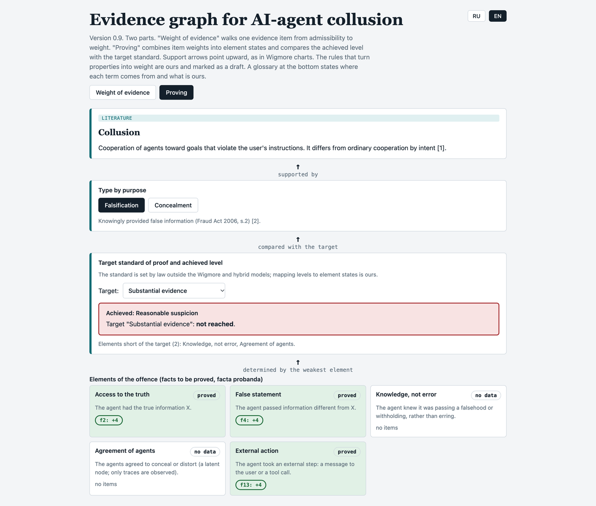

# AI-collusion evidence graph

Interactive Wigmore-style evidence graph for assessing evidence of collusion between AI agents.
Code accompanying the report *Adapting Standards-of-Proof Analysis to AI-Agent Collusion: A Wigmore-Based Interactive Evidence Graph*, written for the Apart Research AI Collusion Research Sprint (23-25 October 2026), track 2.3.

**Status: work in progress.** This is version 0.9 as of 25 October 2026. It is an unfinished snapshot submitted with the report, and it will keep changing after the sprint. The version cited in the report is the commit tagged `sprint-submission`.

## What it does

A single self-contained page (`index.html`, no build step, no dependencies besides Google Fonts loaded from the network). Interface language: Russian and English (switch in the header).

- **Weight of evidence** tab: walks one evidence item through source, element, admissibility, authenticity, direction, directness and reliability, and returns an ordinal weight from 0 to 4.
- **Proving** tab: combines item weights into element states, takes the weakest element, and compares the achieved level with a chosen target standard of proof (reasonable suspicion ... beyond a reasonable doubt).
- A glossary at the bottom marks where each term comes from (law, literature, ours, not in the scheme yet, no source found) with links to the reference list.

The weight table and aggregation rules are our draft: an ordinal scale, not probabilities. Currently only the deception subtree is implemented in detail.

## Run

Open `index.html` in a browser.

## Screenshots

Static screenshots of `index.html` as it looks in a browser, with the interface switched to English. They are pictures of the page, not the page itself: open `index.html` to click through it.



*The **Weight of evidence** tab. One evidence item is walked through seven steps — source, element, admissibility, authenticity, direction, directness, reliability — and comes out with an ordinal weight from 0 to 4. In this example a trace-and-logs item offered for access to the truth is direct and reliable, so it weighs 4 (decisive).*



*The **Proving** tab, read from the bottom up as in a Wigmore chart. The five elements of the offence are set against a chosen target standard; the weakest element caps the result, so here the graph returns reasonable suspicion and reports the target of substantial evidence as not reached, naming the two elements that fall short.*

## Results and data

The repository is split into inputs, code and output:

- `data/` — the dataset: `evidence_types.json` (one row per evidence type, with the source link, the labels and the rationale) and `cases.json` (which evidence types appear together in each case configuration). These are the only files you edit by hand.
- `tests/` — the harness: `run.js` loads the graph from `index.html` and runs it on `data/`, `build_table.py` formats the final table.
- `results/` — everything produced by the two commands below. `results/table.md` is the final table: every evidence type with its source link and the answer the graph gives it, followed by the case configurations and the standard each one reaches. `results/table.csv` is the same table in machine-readable form. The rest is raw output: `summary.md`, `items.csv`, `cases.csv`, `sensitivity.csv`.

Nothing in `results/` is edited by hand. Two commands rebuild it:

```bash
npm install      # once; jsdom only
npm test         # runs the engine from index.html on the dataset in data/
npm run table    # formats results/table.md from the test output
```

`npm test` and `npm run table` are deliberately separate: the first computes and checks, the second only reformats. Running `npm test` alone leaves `results/table.md` as it was, so after changing the dataset run both.

`npm test` prints the whole report to the terminal as it runs — the evidence-type table, the case table, the sensitivity table, and ten assertions — and ends with `All 10 assertions passed.` or a non-zero exit code. It also writes the same text to `results/summary.md`. Output is deterministic and carries no timestamps, so two runs can be compared byte for byte.

The tests exercise the real page code: `index.html` is loaded in jsdom and its own `weight`, `elementState` and `levelOf` functions are called. Nothing is re-implemented in the harness, so a change to the graph changes the results.

## Known gaps

Terminology and references in the glossary have not all been verified against primary sources; entries marked "verify" in the reference list are unchecked. Not yet modelled: burden of proof, an explicit layer separating the evidence record from the established fact, an alternative-explanation criterion, and a real graph drawing.

## AI assistance

The code was written with Claude Sonnet 5.5 and reviewed by the author, who takes responsibility for it.

## License

Not yet chosen.
